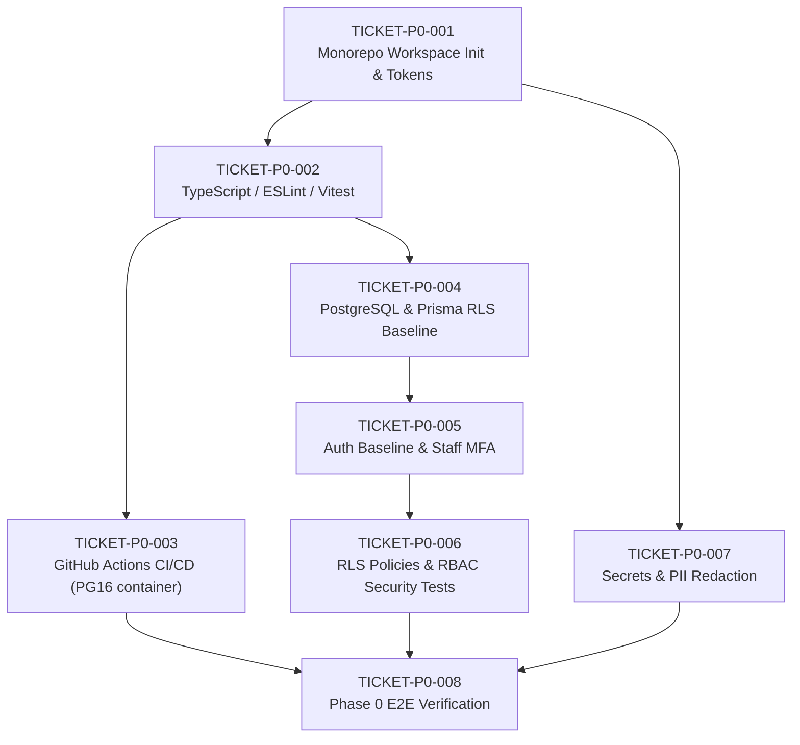

# VisaHobe — Phase 0 Foundation Tickets Index

This directory contains the engineering implementation tickets for **Phase 0 — Foundation**, formulated in accordance with Sections 13 & 14 of the Final Architecture Blueprint v2.0 and updated with approved architectural adjustments.

---

## 1. Ticket Overview and Execution Roadmap

| Ticket ID                                                            | Title                                                                          | Priority | Est. Effort | Status        | Core Deliverables                                                                                                                              |
| :------------------------------------------------------------------- | :----------------------------------------------------------------------------- | :------- | :---------- | :------------ | :--------------------------------------------------------------------------------------------------------------------------------------------- |
| [TICKET-P0-001](./TICKET-P0-001-monorepo-initialization.md)          | Monorepo Workspace Initialization and Directory Skeleton                       | **P0**   | 1 day       | **Completed** | Git, pnpm workspaces, Turborepo, directory tree, governance docs, minimal design tokens                                                        |
| [TICKET-P0-002](./TICKET-P0-002-typescript-lint-format-testing.md)   | Shared TypeScript, ESLint, Prettier, and Vitest Configuration                  | **P0**   | 1 day       | **Completed** | `tsconfig.base.json`, ESLint flat config, Vitest workspace                                                                                     |
| [TICKET-P0-003](./TICKET-P0-003-ci-cd-pipeline-setup.md)             | GitHub Actions CI/CD Pipeline and Branch Protection Rules                      | **P0**   | 1 day       | **Completed** | `.github/workflows/ci.yml`, PG16 service container, migration dry-run, RLS isolation checks, secret scanning                                   |
| [TICKET-P0-004](./TICKET-P0-004-database-and-migration-pipeline.md)  | PostgreSQL Setup, Prisma ORM Baseline, and Migration Workflow                  | **P0**   | 2 days      | **Completed** | Docker Compose, Prisma schema, initial RLS policies, single migration-owner rule, migration documentation                                      |
| [TICKET-P0-005](./TICKET-P0-005-auth-mfa-baseline.md)                | Authentication Baseline, Session Management, and Staff MFA                     | **P0**   | 2 days      | **Completed** | `packages/auth`, strict JWT claims (`iss`, `aud`, `exp`, `sub`, `tenant_id`), secure cookies, CSRF protection, mandatory staff MFA             |
| [TICKET-P0-006](./TICKET-P0-006-rbac-and-tenant-rls-foundation.md)   | Row-Level Security (RLS) Policies and RBAC Evaluator                           | **P0**   | 2 days      | **Completed** | PostgreSQL RLS policies (`CREATE POLICY`) as primary boundary, context bridge, RBAC evaluator, signed URL isolation, cross-tenant denial tests |
| [TICKET-P0-007](./TICKET-P0-007-secrets-logging-observability.md)    | Secret Vault Interface, Structured Logging, and Defense-in-Depth PII Redaction | **P0**   | 1.5 days    | **Completed** | Secret vault, JSON logger, field denylist/allowlist, regex redactor, stack sanitizer, automated "no raw PII" test suite                        |
| [TICKET-P0-008](./TICKET-P0-008-phase-0-verification-and-signoff.md) | Phase 0 End-to-End Verification Suite and Sign-Off                             | **P0**   | 1 day       | **Completed** | `scripts/verify-phase-0.ts`, `pnpm verify:phase-0`, formal Sign-Off Report (`docs/architecture/PHASE_0_SIGNOFF_REPORT.md`)                     |

---

## 2. Dependency Graph

---

## 3. Phase 0 Definition of Done (Blueprint Criteria)

In accordance with Section 13 of the Final Blueprint and approved adjustments, Phase 0 is complete when and only when:

1. **User Authentication:** A user can authenticate in the staging / local environment with strictly validated JWT claims and secure cookies.
2. **Cross-Tenant Isolation:** Automated security tests prove cross-tenant read/write/metadata updates and signed URL generations are denied by PostgreSQL RLS.
3. **Continuous Integration:** GitHub Actions CI executes on PostgreSQL 16 service container and passes all status checks on every pull request.
4. **Reproducible Migrations:** Prisma migrations deploy cleanly to an empty PostgreSQL database from scratch under single migration-owner rules.
5. **Zero Secret Leakage & PII Redaction:** Git history and code diffs are verified clean of credentials, and logs scrub PII via field denylists and regex fallbacks.

---

## 4. Phase 1 — Design System & Public Website Tickets Index

| Ticket ID                                                             | Title                                              | Priority | Est. Effort | Status                   | Core Deliverables                                                                                                                                                 |
| :-------------------------------------------------------------------- | :------------------------------------------------- | :------- | :---------- | :----------------------- | :---------------------------------------------------------------------------------------------------------------------------------------------------------------- |
| [TICKET-P1-001](./TICKET-P1-001-design-system-and-liquid-glass-ui.md) | Design System & Liquid Glass UI Component Library  | **P0**   | 2 days      | **Completed**            | `@visahobe/design-system` tokens, CSS vars, Tailwind preset, and `@visahobe/ui` accessible components (`Button`, `Card`, `Badge`, `Input`, `NavbarShell`, etc.)   |
| [TICKET-P1-002](./TICKET-P1-002-nextjs-public-website-and-intake.md)  | Next.js Public Website & Interactive Intake Portal | **P0**   | 3 days      | **Completed**            | Next.js 15 public acquisition site, White + Dark-Green Liquid Glass landing page, interactive eligibility intake wizard, PII-safe intake API, and login shell     |
| [TICKET-P1-003](./TICKET-P1-003-cms-and-country-guides.md)            | CMS Content Pipeline & Country Visa Policy Guides  | **P0**   | 2 days      | **Completed & Verified** | Structured visa guide engine, 6 launch country policy packs, dynamic `/countries` directory and `[slug]` pages, SEO metadata, and draft isolation                 |
| [TICKET-P1-004](./TICKET-P1-004-client-dashboard-workspace.md)        | Client Dashboard Workspace & Live Case Tracker     | **P0**   | 3 days      | **Completed & Verified** | Next.js 15 client portal (port 3001), 5-stage live case tracker, ADR-009 solid Document Vault, safe upload intake with PII scrubbing, and specialist messaging    |
| [TICKET-P1-005](./TICKET-P1-005-android-capacitor-packaging.md)       | Android Mobile App Capacitor Packaging & Bridge    | **P0**   | 2 days      | **Completed & Verified** | Capacitor 6 Android shell, `#0D3B2E` brand theme, navigation allowlist, unified native bridge (camera, biometrics, safe deep-link router), and web fallback shell |

---

## 5. Phase 2 — Internal Operations & Case Management Command Center

| [TICKET-P2-001](./TICKET-P2-001-super-admin-pwa-workspace.md) | Super Admin PWA & Core Operations Workspace | **P0** | 3 days | **Completed & Verified** | Next.js 15 PWA (port 3002), staff MFA & RBAC operations shell, ADR-009 solid high-contrast case queue, document OCR diff review, CMS editorial, and audit log |
| [TICKET-P2-002](./TICKET-P2-002-staff-mfa-rbac-and-core-api.md) | Staff MFA, Granular RBAC & Core Case Operations API | **P0** | 3 days | **Completed & Verified** | Operations API service (`services/api`), tenant isolation, audit logging, Next.js MFA middleware & challenge page, and granular RBAC checks |
| [TICKET-P2-003](./TICKET-P2-003-architecture-blueprint-b2b2c-mcp.md) | Enterprise Blueprint Upgrade (3-Tier B2B2C, Wallet & MCP) | **P0** | 2 days | **Completed & Verified** | Master Blueprint v2.0 upgrade, ADR-010 (B2B2C & wallet), ADR-011 (Autonomy & connectors), and ADR-012 (Scoped MCP servers) |
| [TICKET-P2-004](./TICKET-P2-004-partner-agency-wallet-and-connectors.md) | B2B Partner Agency Onboarding, White-Label Domain Routing & Prepaid Wallet Engine | **P0** | 3 days | **Completed & Verified** | Agency onboarding, white-label custom domain middleware, dynamic branding, prepaid wallet balance, atomic fee deduction & connector registry |
| [TICKET-P2-005](./TICKET-P2-005-vercel-deployment-config.md) | Vercel Monorepo Deployment Config for 3 Next.js Apps | **P0** | 1.5 days | **Completed & Verified** | Vercel monorepo configurations (`vercel.json`), Turborepo build filters, preview secret fallbacks in `next.config.*`, deployment runbook |
| [TICKET-P2-006](./TICKET-P2-006-flagship-luxury-liquid-glass-ui.md) | Flagship Luxury & Liquid Glass UI/UX Overhaul + Interactive Frontend Experience | **P0** | 2.5 days | **Completed & Verified** | Permanent Flagship UI standard (`AGENTS.md`), upgraded `@visahobe/ui` luxury primitives, interactive `/assess` fee & score estimator, B2C/B2B portal switcher, AI Concierge drawer, and Super Admin live filters |

---

## 6. Phase 3 — Super AI Agent & Scoped MCP Server Infrastructure

| Ticket ID     | Title                                              | Priority | Est. Effort | Status      | Core Deliverables                                                                                                                                                |
| :------------ | :------------------------------------------------- | :------- | :---------- | :---------- | :--------------------------------------------------------------------------------------------------------------------------------------------------------------- |
| TICKET-P3-001 | Super AI Agent Engine & Dynamic Partner Connectors | **P0**   | 3 days      | **Planned** | 3-tier autonomy matrix, mandatory consular review gates (`in_review`), pluggable `IPartnerConnector` registry (`@visahobe/integrations`), daily executive digest |
| TICKET-P3-002 | Scoped Admin & Partner MCP Servers (Kernel RLS)    | **P0**   | 2 days      | **Planned** | Admin MCP server (MFA AAL2 enforced), Partner MCP server (PostgreSQL 16 Kernel RLS `tenant_id` isolated), and B2C client concierge shielding                     |
