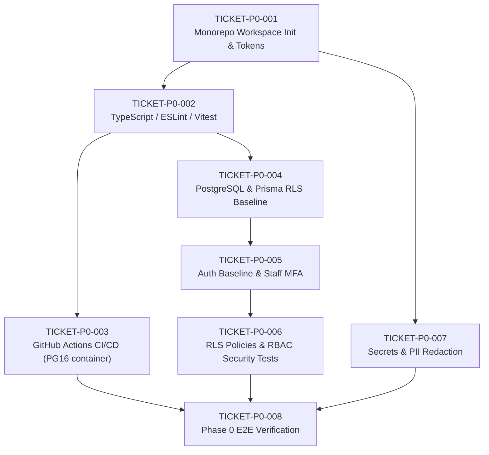

# VisaHobe — Phase 0 Foundation Tickets Index

This directory contains the engineering implementation tickets for **Phase 0 — Foundation**, formulated in accordance with Sections 13 & 14 of the Final Architecture Blueprint v2.0 and updated with approved architectural adjustments.

---

## 1. Ticket Overview and Execution Roadmap

| Ticket ID                                                            | Title                                                                          | Priority | Est. Effort | Dependencies   | Core Deliverables                                                                                                                              |
| -------------------------------------------------------------------- | ------------------------------------------------------------------------------ | -------- | ----------- | -------------- | ---------------------------------------------------------------------------------------------------------------------------------------------- |
| [TICKET-P0-001](./TICKET-P0-001-monorepo-initialization.md)          | Monorepo Workspace Initialization and Directory Skeleton                       | **P0**   | 1 day       | None           | Git, pnpm workspaces, Turborepo, directory tree, governance docs, minimal design tokens                                                        |
| [TICKET-P0-002](./TICKET-P0-002-typescript-lint-format-testing.md)   | Shared TypeScript, ESLint, Prettier, and Vitest Configuration                  | **P0**   | 1 day       | P0-001         | `tsconfig.base.json`, ESLint flat config, Vitest workspace                                                                                     |
| [TICKET-P0-003](./TICKET-P0-003-ci-cd-pipeline-setup.md)             | GitHub Actions CI/CD Pipeline and Branch Protection Rules                      | **P0**   | 1 day       | P0-001, P0-002 | `.github/workflows/ci.yml`, PG16 service container, migration dry-run, RLS isolation checks, secret scanning, branch protection policies       |
| [TICKET-P0-004](./TICKET-P0-004-database-and-migration-pipeline.md)  | PostgreSQL Setup, Prisma ORM Baseline, and Migration Workflow                  | **P0**   | 2 days      | P0-001, P0-002 | Docker Compose, Prisma schema, initial RLS policies, single migration-owner rule, migration documentation standard                             |
| [TICKET-P0-005](./TICKET-P0-005-auth-mfa-baseline.md)                | Authentication Baseline, Session Management, and Staff MFA                     | **P0**   | 2 days      | P0-004         | `packages/auth`, strict JWT claims (`iss`, `aud`, `exp`, `sub`, `tenant_id`), secure cookies, CSRF protection, mandatory staff MFA             |
| [TICKET-P0-006](./TICKET-P0-006-rbac-and-tenant-rls-foundation.md)   | Row-Level Security (RLS) Policies and RBAC Evaluator                           | **P0**   | 2 days      | P0-004, P0-005 | PostgreSQL RLS policies (`CREATE POLICY`) as primary boundary, context bridge, RBAC evaluator, signed URL isolation, cross-tenant denial tests |
| [TICKET-P0-007](./TICKET-P0-007-secrets-logging-observability.md)    | Secret Vault Interface, Structured Logging, and Defense-in-Depth PII Redaction | **P0**   | 1.5 days    | P0-001, P0-002 | Secret vault, JSON logger, field denylist/allowlist, regex redactor, stack sanitizer, automated "no raw PII" test suite                        |
| [TICKET-P0-008](./TICKET-P0-008-phase-0-verification-and-signoff.md) | Phase 0 End-to-End Verification Suite and Sign-Off                             | **P0**   | 1 day       | P0-001..P0-007 | `scripts/verify-phase-0.ts`, Phase 0 Sign-Off report                                                                                           |

---

## 2. Dependency Graph

---

## 3. Phase 0 Definition of Done (Blueprint Criteria)

In accordance with Section 13 of the Final Blueprint and approved adjustments, Phase 0 is complete when and only when:

1. **User Authentication:** A user can authenticate in the staging / local environment with strictly validated JWT claims and secure cookies.
2. **Cross-Tenant Isolation:** Automated security tests prove cross-tenant read/write/metadata updates and signed URL generations are denied by PostgreSQL RLS.
3. **Continuous Integration:** GitHub Actions CI executes on PostgreSQL 16 service container and passes all status checks on every pull request.
4. **Reproducible Migrations:** Prisma migrations deploy cleanly to an empty PostgreSQL database from scratch under single migration-owner rules.
5. **Zero Secret Leakage & PII Redaction:** Git history and code diffs are verified clean of credentials, and logs scrub PII via field denylists and regex fallbacks.
