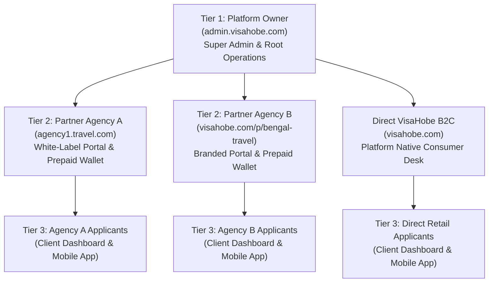
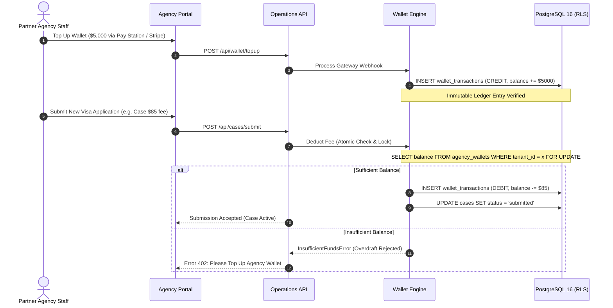
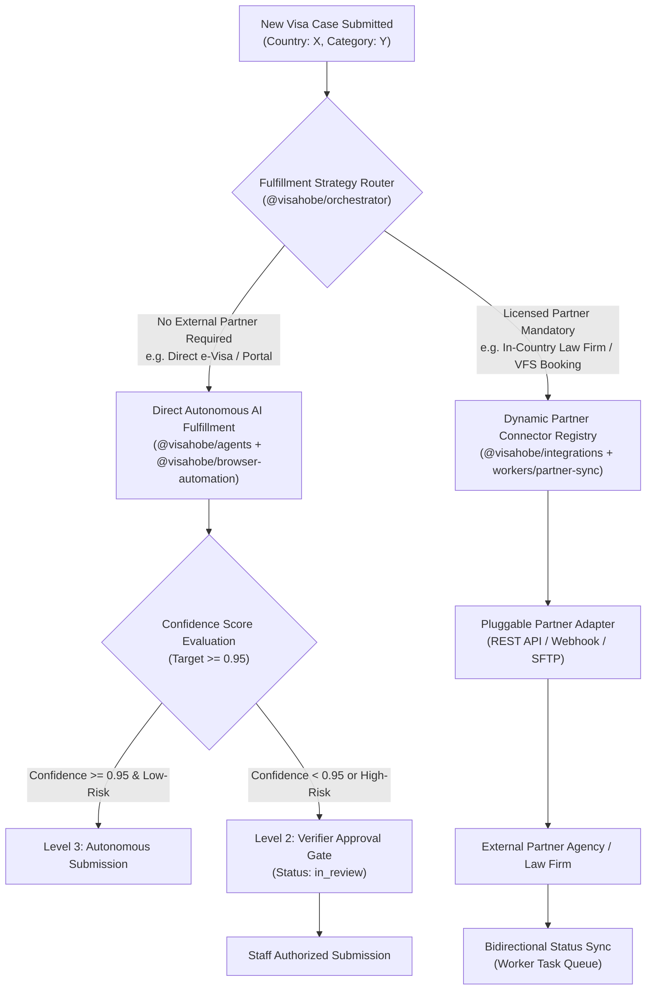
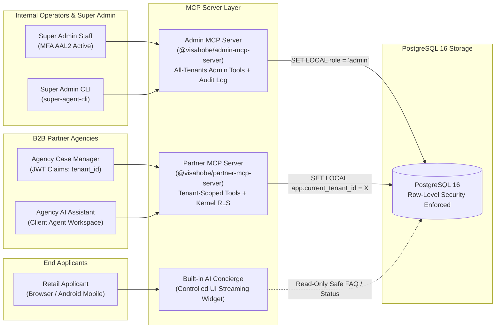

# TICKET-P2-003: Enterprise Architecture Blueprint Upgrade (3-Tier B2B2C SaaS, Prepaid Agency Wallet, Dynamic Partner Connectors, Super AI Agent Autonomy & Scoped MCP Servers)

**Status:** Completed & Verified  
**Priority:** P0 (Foundational Architecture Milestone)  
**Estimated Effort:** 2 days  
**Target Release:** Phase 2 (Enterprise Operations Baseline)  
**Authoritative Documents:**

- `VisaHobe_Final_Architecture_Blueprint_v2.0.md`
- `docs/architecture/decisions/ADR-010-b2b2c-partner-agency-and-prepaid-wallet.md`
- `docs/architecture/decisions/ADR-011-super-ai-agent-autonomy-and-partner-connectors.md`
- `docs/architecture/decisions/ADR-012-scoped-mcp-servers-and-tenant-boundaries.md`
- `AGENTS.md` / `.antigravity/rules.md`

---

## 1. Executive Summary & Objective

The initial VisaHobe architecture was designed as a direct B2C visa assistance platform with internal operator controls. To scale globally across hundreds of partner travel agencies, overseas law firms, and corporate immigration desks, the enterprise architecture requires a unified, high-throughput upgrade:

1. **3-Tier Hierarchical Multi-Tenant B2B2C Model:** Structuring the platform into Tier 1 (Platform Owner / Super Admin), Tier 2 (B2B Partner Travel Agencies with custom domains, white-label branding, and staff seats), and Tier 3 (End Applicants under B2C or Agency sponsorship).
2. **Prepaid Agency Wallet & Immutable Financial Ledger:** Eliminating platform credit risk via an upfront agency wallet model with atomic balance validation, auto-deduction upon visa case submission, and an immutable double-entry ledger.
3. **Hybrid Fulfillment Strategy & Dynamic Partner Connector Registry:** Seamlessly operating between direct autonomous AI visa processing (`@visahobe/agents` + `@visahobe/browser-automation`) and external partner delegation (`@visahobe/integrations` + `workers/partner-sync`) for regional law firms and visa portals.
4. **Super AI Agent Autonomy & Executive Digest:** Implementing a 3-level confidence-based autonomy matrix, mandatory Human-in-the-Loop review gates (`in_review`) for high-risk consular filings, and automated daily executive KPI digests for leadership.
5. **Scoped Model Context Protocol (MCP) Servers:** Providing dedicated, authenticated MCP servers for Super Admin operators (AAL2 MFA required) and Partner Agencies (strictly isolated by `tenant_id` via PostgreSQL 16 Kernel RLS), while shielding B2C applicants behind a safe AI Concierge.

---

## 2. Core Architectural Pillars

### 2.1 3-Tier Hierarchical Multi-Tenant B2B2C Model

- **Tier 1 (Platform Owner / Super Admin):** `admin.visahobe.com` (Port 3002). Root governance, cross-tenant system metrics, global provider routing, billing oversight, and security auditing.
- **Tier 2 (B2B Partner Travel Agencies):** Managed entities with white-label branding (logo, primary color, company info), custom domain/subdomain routing, agency staff/case manager seats, and wholesale pricing tiers.
- **Tier 3 (End Applicants):** Direct retail or agency-sponsored applicants accessing `app.visahobe.com` or white-label portal, Android app, solid document vault, and live 5-stage case timeline.

### 2.2 Prepaid Agency Wallet & Double-Entry Ledger

- **Zero Overdraft Invariant:** An agency cannot initiate automated processing or case submission without sufficient settled funds in their prepaid wallet.
- **Atomic Locking:** Balance deduction uses pessimistic locking (`SELECT ... FOR UPDATE`) within a database transaction context to prevent race conditions during bulk case uploads.
- **Auditable Reconciliation:** Every movement of funds is recorded in `wallet_transactions` referencing `tenant_id`, `case_id`, `amount`, `balance_before`, `balance_after`, `reference_type`, and cryptographic checksums.

### 2.3 Hybrid Fulfillment & Dynamic Partner Connector Registry

- **Pluggable Interface (`IPartnerConnector`):**
  - Standardized lifecycle methods: `dispatchCase()`, `fetchCaseStatus()`, `syncDocuments()`, and `handleWebhook()`.
  - Independent connector adapters for regional immigration firms, embassy submission desks, and courier services.
- **Direct Autonomous AI:** Headless browser automation and form population executing through `@visahobe/browser-automation` with strict domain allowlists and human takeover support.

### 2.4 Super AI Agent Autonomy & Executive Digest

| Autonomy Level | Designation               | Scope & Behavior                                                                                           | Verification Gate                                                                                |
| :------------- | :------------------------ | :--------------------------------------------------------------------------------------------------------- | :----------------------------------------------------------------------------------------------- |
| **Level 1**    | **Assisted Draft**        | AI extracts OCR data, flags document discrepancies, drafts statutory visa application forms.               | Mandatory staff review before saving form state.                                                 |
| **Level 2**    | **Semi-Autonomous**       | AI prepares complete case package, validates eligibility checklist, prepares submission payloads.          | **Verifier Gate (`in_review`):** Human case manager must explicitly authorize before submission. |
| **Level 3**    | **Autonomous Submission** | Automated submission to official government e-visa portals (e.g. Singapore, UAE, Turkey standard e-visas). | Restricted to pre-approved country/visa categories with confidence score >= 0.95.                |

- **Mandatory Consular Gate:** Under no circumstances may an AI agent execute fee payments on live government portals or schedule consular biometrics without explicit human authorization.
- **Daily Executive Digest:** Scheduled daily cron worker generating executive platform summaries:
  - Total active cases, new submissions, completed visas.
  - Overall agent success rate and autonomous vs assisted ratios.
  - Agency wallet balances, low-balance warnings, total processed volume.
  - SLA breach warnings and stalled case escalations.

### 2.5 Scoped Model Context Protocol (MCP) Architecture

- **Admin MCP Server:** Unrestricted operational capability across all tenants, strictly guarded by staff session validation, AAL2 MFA requirement, and audit logging of every tool invocation.
- **Partner MCP Server:** Isolated to the calling agency's `tenant_id`. Every tool query injects session variables `SET LOCAL app.current_tenant_id = '<agency-uuid>'` and `SET LOCAL app.current_user_role = 'partner'`. Any attempt to read or modify external tenant records triggers an immediate database RLS rejection.
- **B2C Shielding:** Retail applicants do not have access to raw MCP tool servers; they interact exclusively with a client concierge UI widget with fixed domain intent constraints.

---

## 3. Associated Architectural Decisions

This ticket incorporates three formal Architecture Decision Records:

1. `ADR-010`: B2B2C Multi-Tenant Architecture, Agency White-Labeling, and Prepaid Wallet Engine
2. `ADR-011`: Super AI Agent Autonomy Matrix, Consular Review Gates, and Dynamic Partner Connectors
3. `ADR-012`: Scoped Model Context Protocol (MCP) Servers and Multi-Tenant Kernel RLS Boundaries

---

## 4. Verification and Acceptance Criteria

- [x] Master Blueprint `VisaHobe_Final_Architecture_Blueprint_v2.0.md` updated with 3-tier B2B2C, prepaid wallet, dynamic partner connectors, agent autonomy, and scoped MCP servers.
- [x] `ADR-010`, `ADR-011`, and `ADR-012` authored and indexed in `docs/architecture/decisions/README.md`.
- [x] Roadmap in `docs/architecture/tickets/README.md` updated with `TICKET-P2-004`, `TICKET-P3-001`, and `TICKET-P3-002`.
- [x] `AGENTS.md` and `.antigravity/rules.md` synchronized and 100% identical.
- [x] Full 7-step pre-push gate passed (`pnpm install --frozen-lockfile`, `pnpm format:check`, `pnpm lint`, `pnpm typecheck`, `pnpm test`, `pnpm build`, `pnpm verify:phase-0`).
