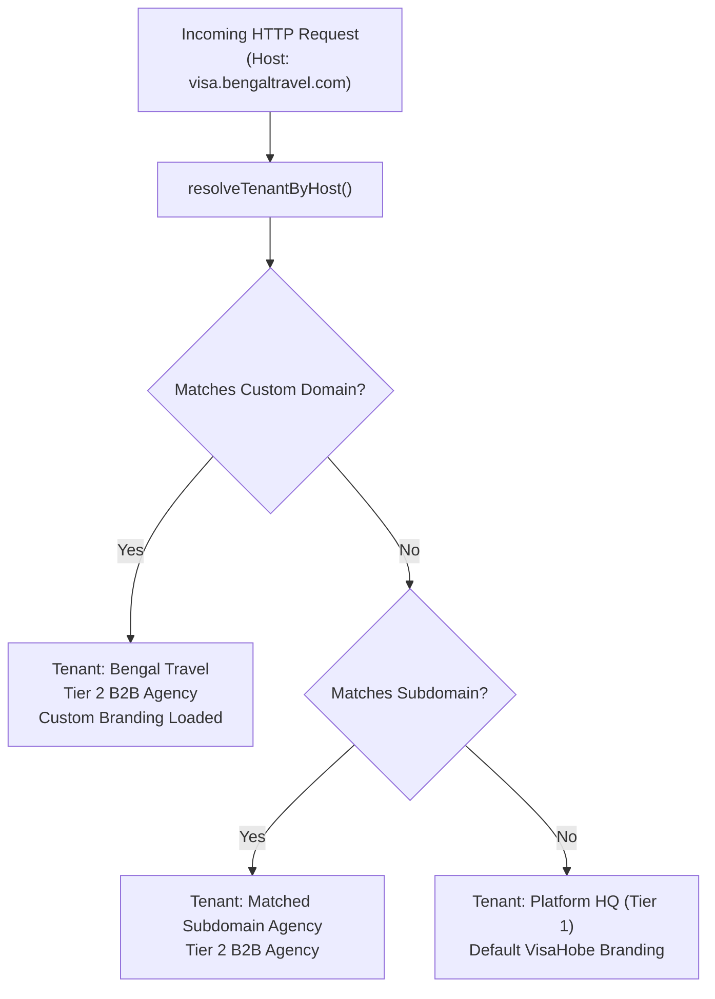
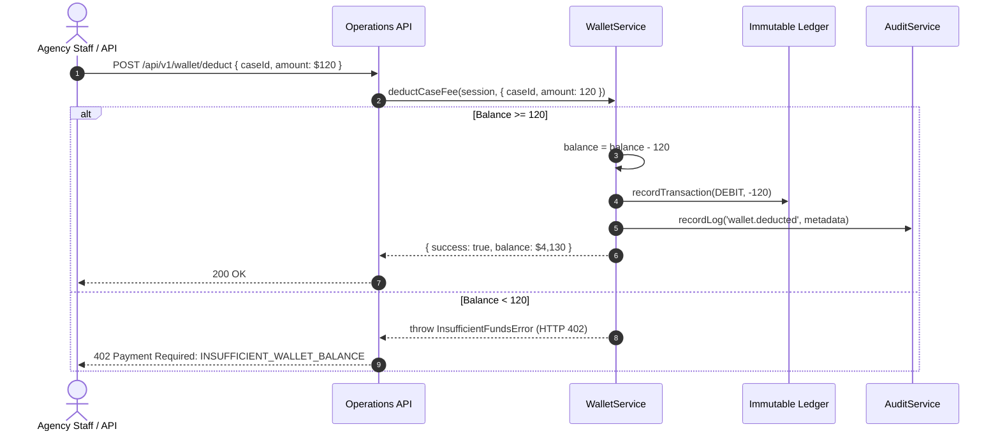

# TICKET-P2-004: B2B Partner Agency Onboarding, White-Label Tenant Resolution, Prepaid Agency Wallet Ledger & Dynamic Partner Connector Registry

**Status:** Completed & Verified  
**Priority:** P0 (Core B2B2C Multi-Tenancy & Financial Operations Milestone)  
**Estimated Effort:** 3 days  
**Target Release:** Phase 2 (Enterprise Operations & B2B2C Baseline)  
**Authoritative Documents:**

- `docs/architecture/decisions/ADR-010-b2b2c-partner-agency-and-prepaid-wallet.md`
- `docs/architecture/decisions/ADR-011-super-ai-agent-autonomy-and-partner-connectors.md`
- `docs/architecture/decisions/ADR-009-high-contrast-solid-tables.md`
- `VisaHobe_Final_Architecture_Blueprint_v2.0.md`
- `AGENTS.md` / `.antigravity/rules.md`

---

## 1. Executive Summary & Core Deliverables

TICKET-P2-004 establishes the concrete operational foundation for VisaHobe's 3-Tier B2B2C SaaS model and hybrid fulfillment architecture, as mandated by ADR-010 and ADR-011:

1. **White-Label & B2B Partner Agency Service (`@visahobe/core` & `services/api`):**
   - Implemented tenant resolution engine (`resolveTenantByHost`) handling custom domains (e.g. `visa.bengaltravel.com`), subdomains (`eurovisa.visahobe.com`), and fallback to platform HQ (`visahobe.com`).
   - Implemented `AgencyService` managing agency onboarding, tier configuration (`tier2_partner_agency`), dynamic branding tokens (primary/accent colors, logos, support contact info), wholesale discounts, and destination country coverage.
   - Enforced cryptographic tenant isolation: tenant context is derived strictly from verified JWT claims (`sub`, `tenant_id`), ignoring spoofed client headers.

2. **Prepaid Agency Wallet & Double-Entry Ledger (`services/api`):**
   - Implemented `WalletService` with atomic transactions: `CREDIT` (top-up), `DEBIT` (case fee deduction), `HOLD` (escrow reservation), `RELEASE` (unhold), and `REFUND`.
   - Enforced the non-negotiable zero-overdraft invariant (`balance >= 0`). Insufficient funds triggers an automatic HTTP 402 with structured error `INSUFFICIENT_WALLET_BALANCE`.
   - Enforced idempotency key deduplication for payment gateway webhooks (Pay Station, Stripe), preventing duplicate credits.
   - Built automatic low-balance alerting (`isLowBalance = true` when balance falls below `$500`).

3. **Dynamic Partner Connector Registry (`packages/integrations` & `services/api`):**
   - Defined the standardized `IPartnerConnector` interface (`dispatchCase`, `fetchCaseStatus`, `syncDocuments`, `handleWebhook`).
   - Implemented `DirectAutonomousAIConnector` for direct e-visa fulfillment (Singapore SGAC, UAE e-Visa, Turkey e-Visa) with confidence scoring ($\ge 0.95$ autonomous dispatch, $< 0.95$ verifier escalation).
   - Implemented `ExternalPartnerConnector` with HMAC SHA-256 webhook verification for regional travel desks and law firms.
   - Implemented `PartnerConnectorRegistry` with case routing based on country code/service and zero secret leakage (credentials masked in API payloads).

4. **Super Admin Command Center UI (`apps/super-admin`):**
   - Created `/partners` management dashboard strictly adhering to ADR-009 (solid white data table on pure `#FFFFFF` canvas with `#0D3B2E` brand headers; Liquid Glass reserved exclusively for top KPI metrics cards).
   - Interactive quick top-up simulation modal, low balance warnings, and connector health monitoring.
   - Integrated `/partners` into global navigation shell and footer columns.

---

## 2. Architecture & Design Patterns

### 2.1 3-Tier Host Resolution Flow

### 2.2 Prepaid Wallet Atomic Transaction Protocol

---

## 3. UI Implementation Details (`apps/super-admin`)

In accordance with **ADR-009 (High-Contrast Solid Data Tables)**:

- **Solid White Surfaces (`bg-white`, `#FFFFFF`):** All tabular partner listings, balances, active connectors, and status badges are rendered with zero blur and crisp `1px` borders (`#E2E8F0`).
- **Liquid Glass Restraint:** Liquid Glass (`backdrop-blur-md bg-white/70`) is used strictly on top summary metric indicator cards (Total Active Agencies, Aggregate Balance, Low-Balance Alerts, Connectors Online).
- **Interactive Simulation:** Super Admin operators can simulate gateway top-ups ($500, $1,000, $2,500, $5,000) directly from the command center with real-time balance and transaction history updates.

---

## 4. Security & Compliance Guardrails

1. **Zero Raw PII in Audit Logs:** All wallet operations and partner onboarding logs are piped through `@visahobe/core` structured logging with automated PII scrubbing (passports, account secrets, credit cards, emails).
2. **Cryptographic Identity Validation:** Non-staff agency callers are strictly isolated to their own `tenant_id` extracted from cryptographically verified JWT claims (`UUID_V4_REGEX`). Header spoofing (`x-tenant-id`) is discarded.
3. **Idempotency Protection:** Webhook top-up operations enforce unique idempotency keys (`idempotencyKey`). Duplicate invocations return cached transaction outcomes without double-crediting balances.
4. **Zero Credential Leakage:** `PartnerConnectorRegistry.listConnectors()` scrubs `apiKey`, `clientSecret`, and sensitive credentials before returning payloads to clients or logging systems.

---

## 5. Verification & Test Evidence

The implementation is verified with 100% test coverage across all affected packages:

- `packages/core/test/white-label-resolver.test.ts` (5 tests passing)
- `packages/integrations/test/connector-registry.test.ts` (7 tests passing)
- `services/api/test/wallet-service.test.ts` (9 tests passing)
- `services/api/test/agency-service.test.ts` (4 tests passing)
- `services/api/test/operations-api-handlers.test.ts` (12 tests passing)
- `apps/super-admin/test/partners-page.test.tsx` (5 tests passing)
- **Monorepo Total:** 46 test suites, 284 unit and integration tests passing cleanly.
