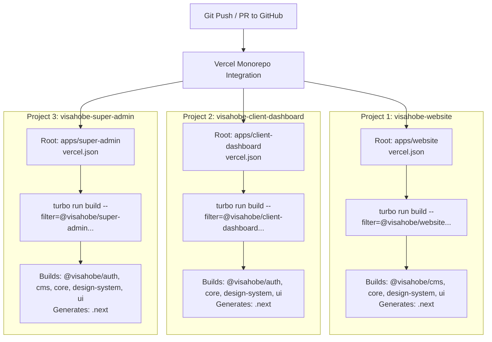

# TICKET-P2-005: Vercel Monorepo Staging/Preview Deployment Configuration for Next.js Applications

**Status:** Completed & Verified  
**Priority:** P0 (Production & Preview CI/CD Readiness Milestone)  
**Estimated Effort:** 1.5 days  
**Target Release:** Phase 2 (Enterprise Operations & Multi-App Deployment Baseline)  
**Authoritative Documents:**

- `docs/deployment/vercel-preview-guide.md`
- `VisaHobe_Final_Architecture_Blueprint_v2.0.md`
- `AGENTS.md` / `.antigravity/rules.md`

---

## 1. Executive Summary & Core Deliverables

TICKET-P2-005 establishes the authoritative Vercel staging, preview, and production deployment configuration for VisaHobe's 3 Next.js App Router applications (`@visahobe/website`, `@visahobe/client-dashboard`, `@visahobe/super-admin`):

1. **Vercel Monorepo Configuration (`vercel.json`):**
   - Implemented dedicated, valid `vercel.json` configurations in `apps/website`, `apps/client-dashboard`, and `apps/super-admin`.
   - Explicitly configured `framework: "nextjs"` and `installCommand: "pnpm install --frozen-lockfile"`.
   - Configured `buildCommand` to invoke Turborepo with targeted package filters (`turbo run build --filter=@visahobe/<app>...`), automatically building upstream workspace packages in topological order before generating Next.js outputs.

2. **Safe Preview Secrets Fallback Protocol (`next.config.mjs`):**
   - Enhanced `next.config.mjs` across all 3 applications to safely inject fallback preview secrets (`JWT_SECRET`, `STORAGE_SECRET`, `DATABASE_URL`) during static preview and CI build phases.
   - Prevents static page generation failures on Vercel preview environments when runtime production secrets have not yet been provisioned, without weakening strict runtime validation in `@visahobe/auth` or `@visahobe/core`.

3. **Vercel Monorepo Deployment Runbook (`docs/deployment/vercel-preview-guide.md`):**
   - Documented the multi-app architecture on Vercel, project settings (Root Directory, Framework Preset, Node.js 20.x, pnpm package manager).
   - Detailed required environment variables for all 3 applications across Preview and Production stages.
   - Documented Turborepo remote caching integration and `npx turbo-ignore` optimization for pull request previews.

4. **Automated Configuration Test Suite:**
   - Added unit/config validation test suites in all 3 applications verifying that each `vercel.json` exists, parses as valid JSON, targets Next.js, and specifies the exact Turborepo build filter matching the package's canonical name.

---

## 2. Monorepo Deployment Architecture

---

## 3. Verification & Test Evidence

1. **Config Validation Tests:**
   - `apps/website/test/vercel-config.test.ts` (2 tests passing)
   - `apps/client-dashboard/test/vercel-config.test.ts` (2 tests passing)
   - `apps/super-admin/test/vercel-config.test.ts` (2 tests passing)
2. **Turborepo Execution:**
   - Verified `pnpm exec turbo run build --filter=@visahobe/<app>...` builds upstream dependencies and downstream applications without caching or module resolution errors.
3. **Monorepo Test Suite:**
   - 49 test files passing across all projects.
   - 290 tests passing with 0 failures.
